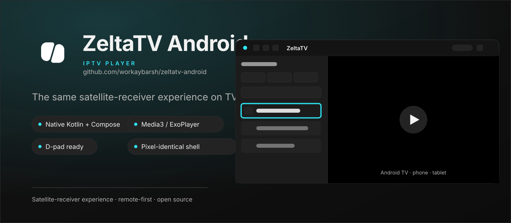
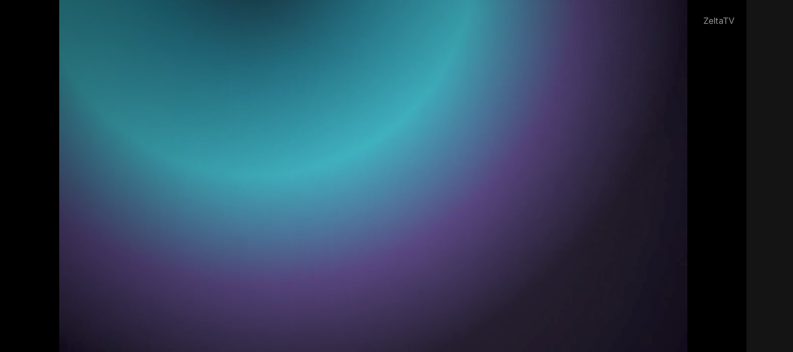
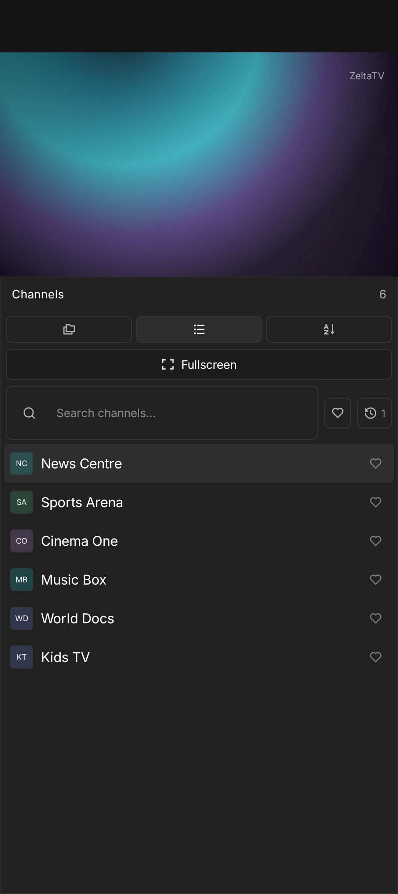
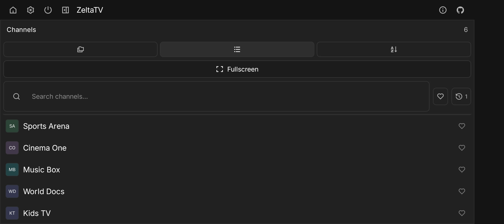
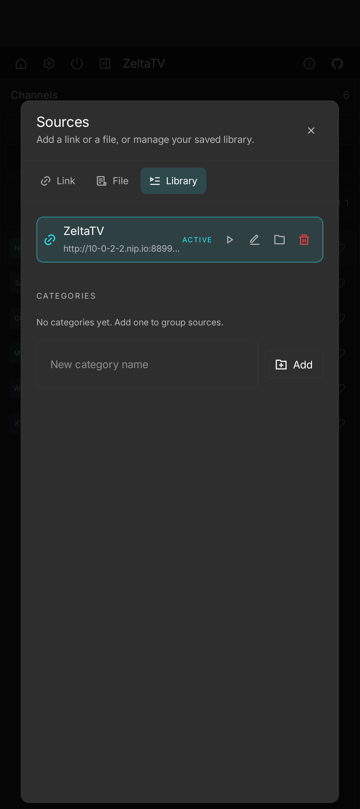
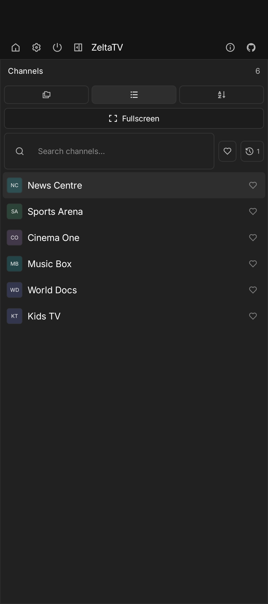
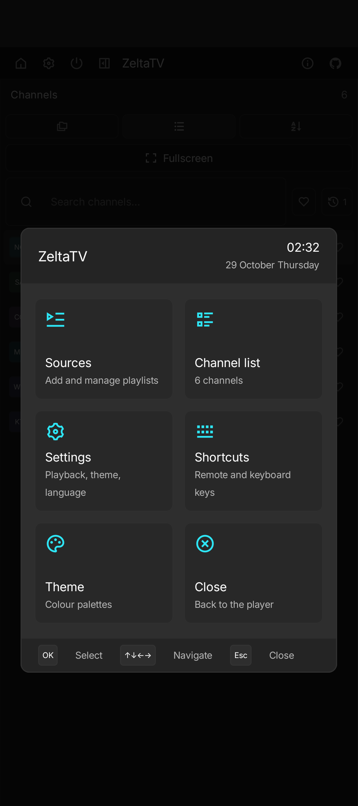
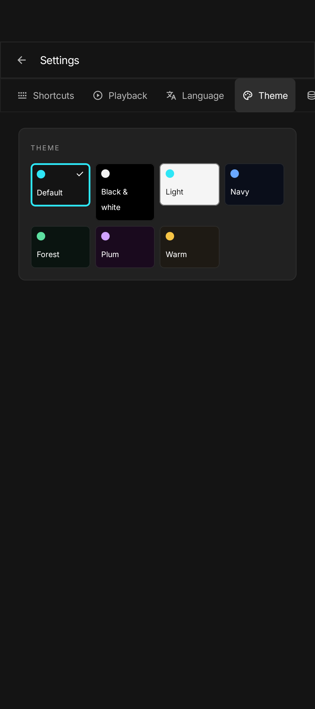
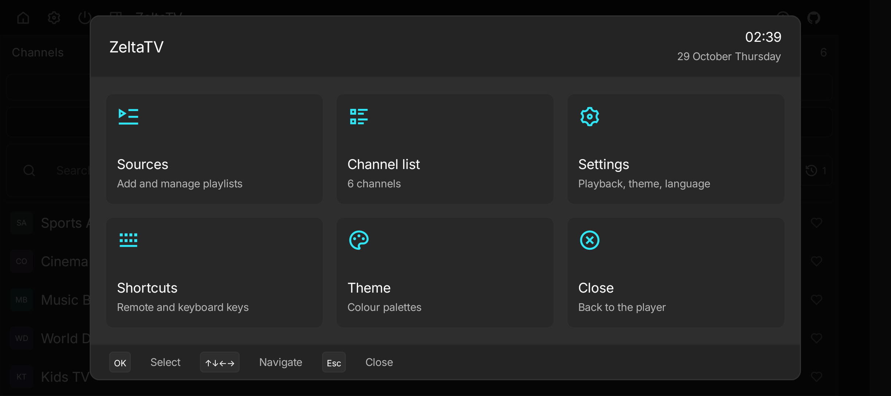

# ZeltaTV Android

<p align="center">
  
</p>

Native Android TV, phone and tablet edition of [ZeltaTV](https://github.com/zeltatv/zeltatv), built
with Kotlin, Jetpack Compose and Media3/ExoPlayer. Same shell as the desktop app, designed for a
remote and for touch.

## Download

[**Download ZeltaTV APK**](https://github.com/zeltatv/android/releases/latest) - the APK is
debug-signed and intended for sideloading.

## Photo Gallery

<p align="center">
  
</p>

| | |
|---|---|
|  |  |
|  |  |
|  |  |

<p align="center">
  
</p>

## Features

- Desktop-identical shell: top bar, channel rail, full-bleed player, channel menu and settings
- 18 languages and seven colour palettes
- Sources by link, file or library, with categories and a tile library on first run
- Search, favourites, history, numeric zap and quality selection
- Android TV D-pad layout, phone portrait and landscape, 44 dp touch targets
- Restores the last source and channel on relaunch

## Build

```powershell
.\gradlew.bat :app:assembleDebug
```

APK: `app/build/outputs/apk/debug/zeltatv.apk`

## Test

```powershell
.\gradlew.bat :core:playlist:test
```

## Licence

GPL-3.0-only.
