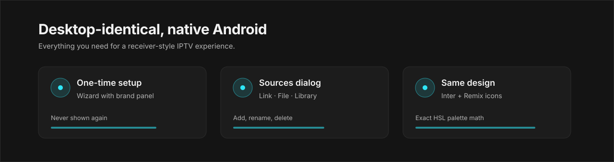

# ZeltaTV Android

<p align="center">
  
</p>

A separate working repository for the Android TV, phone and tablet edition of ZeltaTV.

Desktop edition: [zeltatv/zeltatv](https://github.com/zeltatv/zeltatv)
Original project: [zeltatv/zeltatv](https://github.com/zeltatv/zeltatv)

## Download

- [ZeltaTV Android 1.0.0 (APK)](https://github.com/zeltatv/android/releases/tag/v1.0.0)

Download `zeltatv.apk`. The APK is debug-signed and intended for sideloading. A signed Play Store
AAB requires a private key and a store account, so it is still the next step.

## 1.0.0 update (2026-10-27)

- Setup wizard is English-only and opens with a **Language** step; the chosen language applies to the rest of the app
- Portrait phone flow: the channel rail, sources, settings and the main menu work in portrait
- Portrait playback: the player sits in a 16:9 band above the channel list; rotation is no longer forced, so a phone can be used upright while watching
- Touch first: tapping the video toggles the transport bar (the channel menu is one tap away) and every transport button is a 44dp target
- Responsive setup card (brand panel hides on narrow screens) and dialog layouts
- Publisher links point to the `zeltatv` organisation

## Features (1.0.0)

- Pixel-identical desktop shell: Inter typeface, Remix icons, 36 dp top bar, 256 dp channel rail
- Top bar with home, menu, **+** sources and **×** quit confirmation, matching the desktop window
- One-time setup: after finishing (or choosing "Set up later") the wizard never returns
- Sources dialog with **Link**, **File** and **Library** tabs; add, rename, delete, categories and play
- Desktop-parity shell: adaptive top bar, 256 dp channel rail, full-bleed player and main menu
- First-run wizard with a brand panel, step rail and demo fallback
- Add an M3U/M3U8 source from a URL or the SAF file picker; store sources/categories in Room
- Store, delete, reselect, rename and categorise sources on the device
- Channel search, favourites, favourite filter and category browsing
- Native Media3/ExoPlayer HLS playback, error and retry, quality selection
- Channel menu, numeric zap, OSD seek, clock/source banner and automatic first channel
- Settings tabs matching the desktop page: Shortcuts, Playback, Language, Theme, Data and About
- Appearance: classic/Enhanced skins and seven theme palettes generated with the desktop HSL rules
- Two-pane D-pad layout for Android TV; compact single-pane layout for phone/tablet
- Restore the last source and last channel on relaunch
- Arrow-key seeking and channel zapping only in fullscreen, as on the desktop
- Clear app data on uninstall (`android:allowBackup="false"`)

<p align="center">
  
</p>

## Structure

```
app/        Compose UI, MainActivity, PlayerViewModel, data layer
core/       Pure Kotlin M3U parser + JVM tests
gradle/     Version catalog and wrapper
scripts/    Windows AVD/build/smoke scripts
docs/       Architecture, test plan, roadmap
licenses/   Inter (OFL) and Remix Icon licence texts
```

## Why native?

The Android edition is planned as **native Media3/ExoPlayer**, not as a Capacitor/WebView + hls.js
wrapper. IPTV providers not sending CORS headers, 4K/HEVC, AC-3/E-AC-3 audio, MPEG-TS/RTSP and TV
lifecycle requirements all become fragile on the WebView path. Full decision:
[docs/architecture.md](docs/architecture.md).

## Requirements

- JDK 21 (JAVA_HOME)
- Android SDK: platform-tools, emulator, platforms;android-35, build-tools
- Virtualisation (Hyper-V/WHPX) must be enabled on Windows
- Test AVDs: `ZeltaTV_TV_1080p`, `ZeltaTV_Phone`, `ZeltaTV_Tablet`

## Quick start

```powershell
# prepare the environment variables (dot-source)
. .\scripts\android\env.ps1

# create the AVDs (first time)
.\scripts\android\create-avds.ps1

# start the TV emulator
.\scripts\android\start-emulator.ps1 -Profile tv

# build and install the debug APK, launch it and collect smoke evidence
.\scripts\android\run-smoke.ps1
```

PowerShell scripts are unsigned by default, so if needed:

```powershell
powershell -NoProfile -ExecutionPolicy Bypass -File .\scripts\android\run-smoke.ps1
```

## Build

```powershell
.\gradlew.bat :core:playlist:test :app:assembleDebug
```

APK: `app/build/outputs/apk/debug/zeltatv.apk`. Packaging and signing:
[docs/packaging.md](docs/packaging.md)

## Test

```powershell
# JVM parser tests
.\gradlew.bat :core:playlist:test

# UiAutomator D-pad smoke test on a connected emulator
.\gradlew.bat :app:connectedDebugAndroidTest
```

Test matrix and acceptance criteria: [docs/test-plan.md](docs/test-plan.md)

## Roadmap

M1, M2 and the 1.0.0 desktop-parity release are complete. The next steps are a signed Play Store
AAB, on-device performance measurements and expanded player settings. Details:
[docs/roadmap.md](docs/roadmap.md)

## Non-ASCII project path on Windows

If the project path contains non-ASCII characters, the Gradle test worker may fail to read the
classpath. Workaround: map the project to an ASCII drive letter and run it from there.

```powershell
subst Z: "C:\Users\<user>\Documents\Varsayılan Proje\zeltatv-android"
Z:\gradlew.bat -p Z:\ :core:playlist:test :app:assembleDebug
```

CI runs on Linux, so this problem does not occur there.

## Licence

GPL-3.0-only. Details: [LICENSE](LICENSE)
